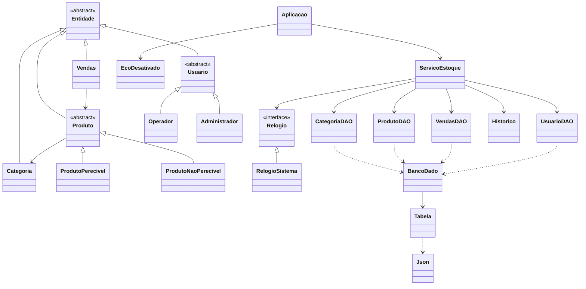

# Cartões CRC — Sistema de Estoque

Cartões **C**lasse–**R**esponsabilidade–**C**olaborador do sistema. Cada cartão diz *o que a classe sabe e faz*
(responsabilidades) e *com quem ela precisa conversar para isso* (colaboradores). Os nomes são os das classes reais
em `include/`.

## Visão geral



Camadas (de cima para baixo cada uma só conhece a de baixo):

```
  Aplicacao            conversa com o usuário (menus, tabelas, leitura de dados)
      |
  ServicoEstoque       regras de negócio, permissões, histórico, alertas
      |
  *DAO                 gravar/consultar entidades; integridade (FK, unicidade)
      |
  BancoDado / Tabela   arquivos JSON (leitura, gravação atômica)      Json, Data, Horario, crypto
```

---

## Modelo (entidades)

### Entidade «abstrata»
| | |
|---|---|
| **Subclasses** | Categoria, Produto, Vendas, Usuario |
| **Responsabilidades** | Guardar o `id` (0 = ainda não gravada) · validar e limpar campos de texto (`valida_texto`: obrigatório, até 255 caracteres, sem caracteres de controle) · **exigir** que toda entidade saiba se converter em JSON (`para_json`) e se resumir em uma frase (`resumo`) |
| **Colaboradores** | Json, ErroValidacao |

### Categoria
| | |
|---|---|
| **Superclasse** | Entidade |
| **Responsabilidades** | Guardar e validar o nome da categoria · converter de/para uma linha JSON |
| **Colaboradores** | Json, ErroPersistencia |

### Produto «abstrata»
| | |
|---|---|
| **Superclasse / Subclasses** | Entidade / ProdutoPerecivel, ProdutoNaoPerecivel |
| **Responsabilidades** | Guardar nome, quantidade, valor, data de chegada, descrição e categoria, garantindo os invariantes (quantidade e valor dentro da faixa) · retirar do estoque (`baixa_estoque`), repor (`repoe_estoque`) e calcular o valor de N unidades (`calcula_valor`) · mostrar a validade (`validade_formatada`) · converter de/para JSON · **fábricas** `cria` e `de_json`, que escolhem a subclasse certa · **declarar o comportamento polimórfico** `get_validade_produto`, `esta_vencido`, `dias_para_vencer`, `get_tipo` |
| **Colaboradores** | Categoria, Data, Json, ErroValidacao, ErroEstoqueInsuficiente, ErroRegraNegocio |

### ProdutoPerecivel
| | |
|---|---|
| **Superclasse** | Produto |
| **Responsabilidades** | Guardar a data de validade (nunca anterior à chegada) · saber se está vencido e quantos dias faltam |
| **Colaboradores** | Data, ErroValidacao |

### ProdutoNaoPerecivel
| | |
|---|---|
| **Superclasse** | Produto |
| **Responsabilidades** | Representar produto sem validade: nunca vence, não tem data de validade |
| **Colaboradores** | Data |

### Vendas
| | |
|---|---|
| **Superclasse** | Entidade |
| **Responsabilidades** | Guardar uma venda (vendedor, produto, quantidade, valor total, data e horário) com seus invariantes · converter de/para JSON (grava só o id do produto) |
| **Colaboradores** | Produto, Data, Horario, Json |

### Usuario «abstrata»
| | |
|---|---|
| **Superclasse / Subclasses** | Entidade / Operador, Administrador |
| **Responsabilidades** | Guardar o nome de usuário e o **hash** da senha (nunca a senha) · conferir uma senha digitada (`valida_senha`) · converter de/para JSON · fábrica `cria`, que escolhe a subclasse pelo grupo · **declarar** `get_grupo`, `get_nome_grupo` e `pode_administrar` |
| **Colaboradores** | crypto (`valida_senha`), Json, ErroValidacao |

### Operador
| | |
|---|---|
| **Superclasse** | Usuario |
| **Responsabilidades** | Usuário comum: grupo 0, **não** administra o sistema |
| **Colaboradores** | — |

### Administrador
| | |
|---|---|
| **Superclasse** | Usuario |
| **Responsabilidades** | Usuário com acesso total: grupo 1, **pode** administrar (registro de vendas, usuários, histórico) |
| **Colaboradores** | — |

---

## Persistência

### BancoDado
| | |
|---|---|
| **Responsabilidades** | Representar a pasta de dados (criá-la se não existir) · entregar a `Tabela` de cada nome, recusando nomes perigosos (`../x`) · informar o caminho de outros arquivos (histórico). Substitui o `bancodado.py`/MySQL |
| **Colaboradores** | Tabela, ErroPersistencia, ErroValidacao |

### Tabela
| | |
|---|---|
| **Responsabilidades** | Ler e gravar o arquivo JSON de uma tabela · atribuir ids sequenciais **sem reaproveitá-los** (o `auto_increment`) · inserir, atualizar, excluir e listar linhas · **gravar de forma atômica** (arquivo temporário + renomeação) · validar a estrutura do arquivo e **nunca sobrescrever um arquivo corrompido** |
| **Colaboradores** | Json, ErroPersistencia, ErroJson, ErroValidacao |

### CategoriaDAO
| | |
|---|---|
| **Responsabilidades** | Gravar categoria (recusa nome repetido, ignorando maiúsculas e acentos) · listar em ordem alfabética · buscar por id |
| **Colaboradores** | BancoDado, Categoria, texto, ErroIntegridade, ErroNaoEncontrado |

### ProdutoDAO
| | |
|---|---|
| **Responsabilidades** | Gravar produto (a categoria precisa existir: a antiga FK) · listar já com a categoria (o antigo JOIN) · buscar por nome e por id · excluir (recusa se houver vendas) · atualizar a quantidade |
| **Colaboradores** | BancoDado, Produto, Categoria, ErroIntegridade, ErroNaoEncontrado, ErroValidacao |

### VendasDAO
| | |
|---|---|
| **Responsabilidades** | Registrar venda (o produto precisa existir) · listar vendas com produto e categoria · pesquisar por período (limites inclusivos) · somar o valor do período |
| **Colaboradores** | BancoDado, ProdutoDAO, Vendas, Data, ErroIntegridade, ErroValidacao |

### UsuarioDAO
| | |
|---|---|
| **Responsabilidades** | Cadastrar usuário (recusa nome repetido e senha que não esteja criptografada) · conferir login devolvendo a subclasse certa, **sem revelar** se o usuário existe pelo tempo de resposta · listar, buscar, excluir e contar usuários |
| **Colaboradores** | BancoDado, Usuario, crypto, ErroIntegridade, ErroNaoEncontrado |

### Historico
| | |
|---|---|
| **Responsabilidades** | Acrescentar uma linha por operação (`data hora \| usuário \| operação \| detalhe`) em arquivo de texto · devolver as últimas linhas · **nunca lançar exceção ao gravar** (o histórico é secundário) |
| **Colaboradores** | Relogio, ErroPersistencia |

---

## Regras de negócio e interface

### ServicoEstoque
| | |
|---|---|
| **Responsabilidades** | Reunir os casos de uso: primeiro acesso, login/logout, usuários, categorias, produtos, **venda** (confere o estoque no cadastro, calcula o total, grava a venda e **devolve o estoque se a gravação falhar**), reposição, relatórios · **conferir permissões** (`somente administradores`) · gerar os alertas (vencidos, a vencer, estoque baixo) · registrar tudo no histórico |
| **Colaboradores** | CategoriaDAO, ProdutoDAO, VendasDAO, UsuarioDAO, Historico, Relogio, Usuario, Produto, crypto |

### Aplicacao
| | |
|---|---|
| **Responsabilidades** | Conversar com o usuário: menus equivalentes às rotas do Flask (`login`, `index`, `administrativo`, `produtos`, `categoria`, `vendas`, `registro_vendas`...) · ler e converter as respostas · imprimir tabelas alinhadas · mostrar as mensagens de erro **sem encerrar o programa** · encerrar com calma quando a entrada acaba · funcionar com teclado ou com arquivo de texto (simulação) |
| **Colaboradores** | ServicoEstoque, Usuario (polimorfismo: quais telas aparecem), EcoDesativado, texto, FimDeEntrada |

### EcoDesativado
| | |
|---|---|
| **Responsabilidades** | RAII: desligar o eco do terminal durante a digitação da senha e **religá-lo sempre** (fim do escopo, exceção ou sinal de Ctrl+C/kill) |
| **Colaboradores** | (API do sistema: termios, sinais) |

---

## Utilitários

### Json
| | |
|---|---|
| **Responsabilidades** | Representar valores JSON (nulo, booleano, inteiro, real, texto, array, objeto) · **ler** (parser com mensagens de linha/coluna e limite de profundidade) e **escrever** texto JSON · acesso tipado que lança `ErroJson` |
| **Colaboradores** | ErroJson |

### Data
| | |
|---|---|
| **Responsabilidades** | Data sempre válida (ano 1900–9999, bissextos) · ler `aaaa-mm-dd` e `dd/mm/aaaa` · formatar · comparar · calcular dias entre datas |
| **Colaboradores** | ErroValidacao |

### Horario
| | |
|---|---|
| **Responsabilidades** | Horário sempre válido · ler e formatar `hh:mm:ss` · comparar |
| **Colaboradores** | ErroValidacao |

### Relogio «interface»
| | |
|---|---|
| **Subclasses** | RelogioSistema (e `RelogioFixo`, nos testes) |
| **Responsabilidades** | Fonte de data e hora (`hoje`, `agora`), para que o código não dependa do relógio real e os testes sejam previsíveis |
| **Colaboradores** | Data, Horario |

### RelogioSistema
| | |
|---|---|
| **Superclasse** | Relogio |
| **Responsabilidades** | Devolver a data e hora locais do computador |
| **Colaboradores** | Data, Horario |

### crypto / Sha256 / HmacSha256
| | |
|---|---|
| **Responsabilidades** | `cryptar`: gerar o hash de uma senha (PBKDF2-HMAC-SHA256 com sal aleatório) · `valida_senha`: conferir senha × hash em tempo constante, devolvendo `false` (sem exceção) para hash malformado ou com custo absurdo · `Sha256`/`HmacSha256`/`pbkdf2_hmac_sha256`: as primitivas |
| **Colaboradores** | texto (`divide`, `converte_inteiro`), ErroValidacao |

### texto (funções)
| | |
|---|---|
| **Responsabilidades** | Limpar (`remove_espacos`), comparar sem maiúsculas/acentos (`normaliza`), medir/cortar/preencher texto UTF-8, formatar valores (`formata_valor`) e **converter entradas do usuário com validação** (`converte_inteiro`, `converte_real`) |
| **Colaboradores** | ErroValidacao |

### Hierarquia de erros (`ErroEstoque` e derivadas)
| | |
|---|---|
| **Responsabilidades** | Dar um tipo a cada falha prevista, para tratá-la de forma específica ou genérica: `ErroValidacao`, `ErroPersistencia` (`ErroJson`), `ErroNaoEncontrado`, `ErroIntegridade`, `ErroRegraNegocio` (`ErroEstoqueInsuficiente`), `ErroAutenticacao`, `ErroPermissao` |
| **Colaboradores** | todas as classes acima |
